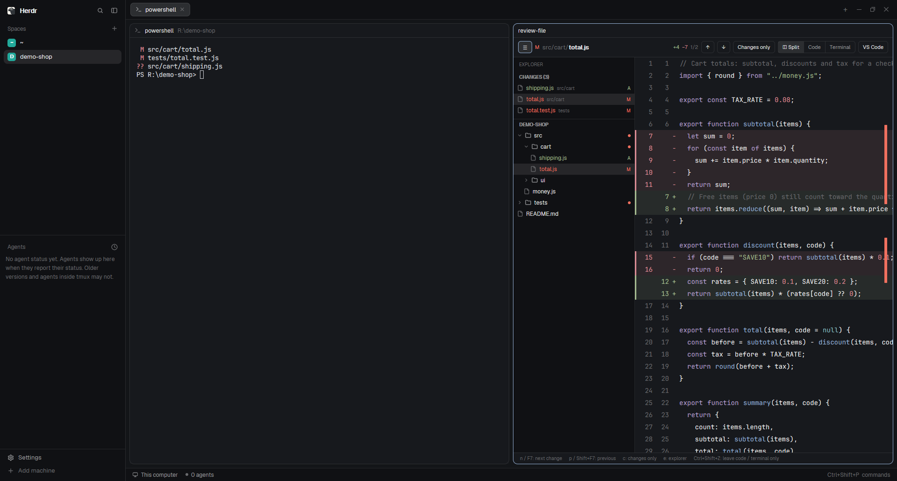

# Code review for Herdr

A [Herdr](https://herdr.dev) layout that adds a VS Code-style code view for reviewing changes,
plus agent tracking inspired by [cmux](https://cmux.com). It is also part of
[Zendr](https://github.com/ruchira-edirisinghe/zendr), a Windows ARM64 build of Herdr's desktop app.



- **Whole files with inline changes.** Open any changed file from the Changes panel and see
  all of it, not just the hunks. Added lines are green and removed lines red, with old and new
  line numbers, syntax colors and an overview ruler beside the scrollbar. Jump between
  changes with ↑ ↓ (or `n` / `p`, F7 / Shift+F7). "Changes only" folds the unchanged parts.
- **Explorer.** A sidebar with the repo's changed files and its full file tree (from
  `git ls-files`, so ignored files stay out). Folders with changes are marked. Click any file to
  read it, changed or not.
- **Split, code only, terminal only.** The code view opens beside your terminal. One click
  shows only the code or only the terminal; Ctrl+Shift+Z (pane zoom) goes back to the split.
- **Live.** The view follows saves in the repo. VS Code opens at the line you're reading.
- **An editor too.** Tabs (a single click previews, a double click keeps the tab), and an Edit
  mode with Ctrl+S save. Line endings are kept, and you're asked if the file changed on disk
  meanwhile. Shortcuts: Ctrl+P quick open (`:42` for a line), Ctrl+G go to line, Ctrl+F / Ctrl+H
  find and replace, Ctrl+/ comment, Ctrl+] / Ctrl+[ indent, Ctrl+Alt+↑ / ↓ add cursors,
  Alt+Z wrap, Ctrl+\ split the editor, Ctrl+W close the tab, F1 for the full list.
- **Ctrl + mouse wheel zoom** in the code view, to show more lines or fewer.
- **Language detection and file icons.** Seti-style icons per file type in the explorer, the tabs
  and the Changes panel. The language comes from the name, a shebang, a modeline or the content.
  Pick another from the status bar.
- **Source control graph.** The toolbar's Graph button opens the repo's commits with their branch
  lines, branch and tag pills and the uncommitted changes. A commit's file opens its change.
- **VS Code extensions.** The command palette's *VS Code extensions* reads the extensions you
  have installed and applies their colour themes (with their code colours) and their languages.
  No extension code runs.
- **More terminals and editors.** The toolbar's split buttons open terminals to the right or below.
  Split editor opens another code view.
- **Arrange blocks** (needs [Zendr](https://github.com/ruchira-edirisinghe/zendr)). The toolbar button
  turns the work area's blocks into cards: drag one onto another block's edge to put it on that side
  (drop on the bottom edge to place it below), or in the middle to swap. Saved to your layout.
- **A switch for everything.** `features` in settings.json (Settings → Features in Zendr) turns off
  `graph`, `code_view`, `code_edit`, `file_icons`, `lang_detect`, `code_zoom`, `vscode_ext`,
  `split_buttons`, `arrange` and `session_counts`, alongside the existing ones.
- **A space starts with just the terminal.** The toolbar's Explorer and Code buttons (or a tab's
  right-click menu) show the explorer and the code reviewer. Each space remembers what it shows.

Inspired by cmux:

- **Notifications drawer.** The toolbar's Notifications button (with an unread count) opens a
  drawer on the right. Agents that need you are pinned on top as cards with Go to it / Dismiss;
  finished agents, session-bridge messages and other toasts follow as a timeline, grouped by day,
  each kind in words with an icon. Mark all read, or pause them all for an hour.
  Ctrl+Shift+I opens it; Ctrl+Shift+U jumps to the latest unread.
- **Notification settings.** The mods follow `notifications` in settings.json: for each kind
  (`blocked`, `done`, `bridge`, `other`) `popup` and `inbox` (and `sound`), plus `quiet_until`,
  `badge` (`count`, `dot`, `off`), `keep`, `read_on_visit`, `rings` and `sidebar_note`. In
  [Zendr](https://github.com/ruchira-edirisinghe/zendr), Settings → Notifications sets them, and
  the app follows pop-up length, do not disturb and sounds by kind.
- **Attention rings.** A pane whose agent needs you gets a tinted header. Its tab lights up.
- **Sidebar line.** Under each space: its listening ports, its branch's pull request (`gh`), its
  [session-bridge](https://github.com/iddhi-sulakshana/claude-mods/tree/main/claude-session-bridge)
  status and its latest unread notification.
- **Agent summaries.** The Sessions list shows each agent's current task and a one-line summary
  (the question it asks, the step it is on, or its last message).

New here:

- **A simple layout.** One Sessions list on the left (each space with its sessions nested under
  it, their state in words), and a toolbar of labelled toggles: Commands, Explorer, Code, Hub and
  Notifications. The hub and the notifications share one drawer on the right (the layout's
  `side` stack). `features.agents_list: true` in settings.json brings back the Agents list.
- **The hub.** A drawer on the right with every agent and what it's doing. The coordinator (a
  Claude Code session that plans the work and messages the others over the session bridge) is
  shown apart at the top. It lists the messages between sessions and has a box to message the
  coordinator, one agent or everyone as you. **Start coordinator** opens one with its brief.
- **Session colours.** Give a session one of twelve named colours, or let it use its space's.
  The colour tints its row in Sessions, its tab and its hub card (stronger when selected). Right-click the row,
  the card or the tab (Colour…), or press Ctrl+Shift+Y. A space's menu sets the space's colour.

Inspired by Warp:

- **Command search** (Ctrl+Shift+R, or the `</>` button in the tab bar). Shell history and saved
  workflows in one list. Enter pastes the command into the terminal to check; Ctrl+Enter runs it.
- **Workflows.** Saved commands with `{{placeholders}}`, in `workflows.json` (save one from history).
- **Ask AI** (Ctrl+Shift+Space). Describe it; Claude Code (`claude -p`) writes the command.
- **Launch configurations** (Ctrl+Shift+J). Save the open spaces and tabs as a setup and reopen it.

## What's in it

| Path | What |
|---|---|
| `layouts/main-review.json` | Herdr's `main` layout, with the Changes block pointing at `review-changes` |
| `mods/review-changes/` | Herdr's Changes panel plus "Open full file" (beside the terminal or in a tab), a ⤢ button per file and double-click |
| `mods/review-file/` | The code view: inline diff, Explorer, Split / Code / Terminal |
| `mods/review-tabs/`, `mods/review-menu/` | Herdr's tab bar and menu, plus the toolbar, the drawer, the per-space Show/Hide items and session-bridge requests |
| `mods/inbox/` | The notifications drawer |
| `mods/review-toast/`, `mods/review-pane/` | Herdr's toast and pane header: toasts go into the inbox; panes ring |
| `mods/review-spaces/`, `mods/review-agents/` | Herdr's sidebar (the Sessions list) and the separate agents list, with the extra lines |
| `mods/hub/` | The hub: the coordinator, every agent, the session-bridge messages and a message box |
| `mods/session-color/` | The colour picker for sessions and spaces |
| `mods/commands/`, `mods/launch/` | Command search (history, workflows, Ask AI) and launch configurations |
| `mods/git-graph/` | The source control graph in the right drawer |
| `mods/vscode/` | VS Code extensions: themes, code colours and languages |

Command palette (Ctrl+Shift+P): **Code view beside the terminal** and **Code view in a new tab**
open the Explorer for the repo you're working in.

## Install

Copy `layouts/` and `mods/` into `~/.config/herdr-app` (Windows: `%USERPROFILE%\.config\herdr-app`),
then switch layouts:

```sh
herdr-app check ~/.config/herdr-app/mods/review-file
herdr-app check ~/.config/herdr-app/mods/review-changes
herdr-app do layout.switch '{"name":"main-review"}'
```

Already on your own layout? Keep it, and point its Changes block at the new mod:
`"content": { "mod": "review-changes" }`. Ctrl+Shift+L switches layouts back.

Keys for `keys.json` (the inbox's are under `global`):

```json
{ "global": { "ctrl-shift-i": "review-tabs.inbox", "ctrl-shift-u": "review-tabs.jump-unread", "ctrl-shift-y": "review-tabs.color",
    "ctrl-shift-r": "review-tabs.command-search", "ctrl-shift-space": "review-tabs.ask-ai", "ctrl-shift-j": "review-tabs.launch" },
  "mod:review-file": { "ctrl-shift-e": "review-file.explorer", "ctrl-alt-c": "review-file.code-only", "ctrl-alt-s": "review-file.split", "ctrl-alt-t": "review-file.terminal-only" } }
```

## What it runs

The code view and Changes panel run `git` read-only in the repo you're working in (`status`, `diff`, `ls-files`,
`rev-parse`, with `--no-optional-locks` so nothing is written under `.git`). "Commit" in the
Changes panel runs `git add -A` and `git commit`, as Herdr's own panel does. "VS Code" runs
`code --goto` (through a `vscode://file/` link). The graph runs `git log`, `git for-each-ref` and `git diff-tree`.
The VS Code extensions dialog only reads `package.json` and theme files in the extension folders. The sidebar runs `gh pr view` for spaces on a branch, and, on Windows, one
PowerShell look at listening ports every 20 seconds while the window is active.

Built for herdr-app 0.1.18. Tested on Windows 11 ARM64.

## License

Apache-2.0, like herdr-app. The `review-*` mods other than `review-file` are modified copies of
herdr-app's shipped mods (their `mod.json` names which one, under `cloned_from`).
